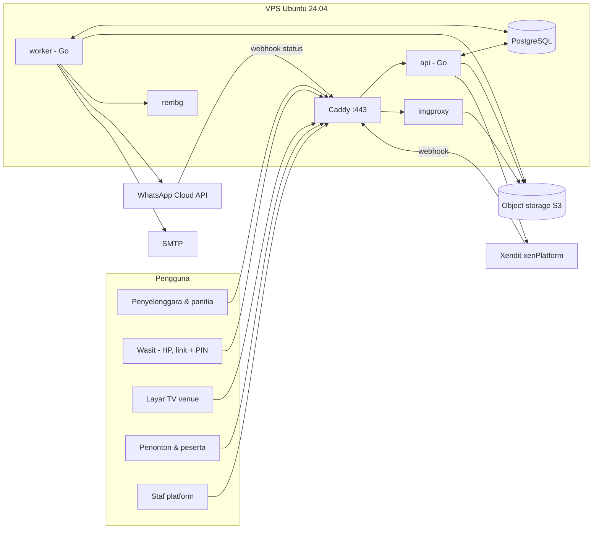
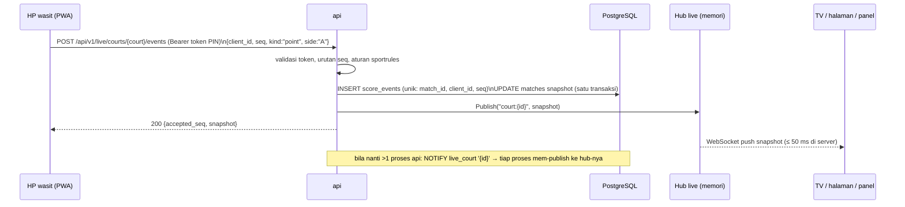
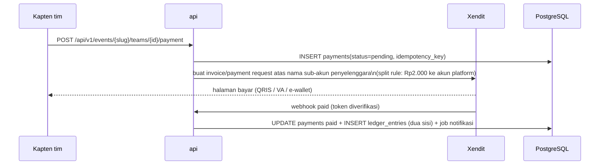
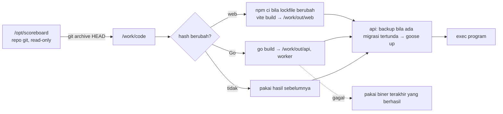

# Arsitektur sistem — scoreboard.tiusapp.com

Versi 0.1 · 11 November 2026. Keputusan besar dan alasannya ada di `docs/DECISIONS.md`.

## 1. Ringkasan keputusan

| Area | Pilihan |
|---|---|
| Bentuk | **Monolit modular**: satu repo, satu program API Go + satu program worker Go, satu PostgreSQL |
| Server | 1 VPS Contabo Ubuntu 24.04 (disarankan region Singapura), semua layanan via Docker Compose |
| Penerapan kode | Repo di `/opt/scoreboard` di-mount read-only ke container; saat start/restart, commit HEAD dikompilasi di container dan dijalankan (ADR-0009) |
| Pintu depan | Caddy (HTTPS otomatis Let's Encrypt), bisa diberi Cloudflare di depannya |
| Backend | Go (stdlib `net/http`), pgx v5, sqlc, goose (migrasi), River (antrean di Postgres), coder/websocket |
| Database | PostgreSQL 18 (kompatibel 16 — skema tidak memakai fitur khusus 18) |
| Frontend | React + TypeScript + Vite, satu SPA untuk semua layar; remote wasit sebagai PWA |
| Logika olahraga | Ditulis di Go (`internal/sportrules`) **dan** TypeScript (`packages/sportrules`), dijaga sama oleh fixture JSON bersama di `testdata/sportrules` |
| Skor live | Log kejadian bernomor urut → hub pub/sub di memori → WebSocket ke TV/halaman/panel |
| Pembayaran | Xendit xenPlatform (sub-akun per penyelenggara, split fee, pencairan) |
| Notifikasi | WhatsApp Business Cloud API (template), email SMTP |
| Berkas | Object storage S3-compatible (Contabo Object Storage) + imgproxy; potong latar via rembg |
| Dokumen | Story & kartu dirender di browser; sertifikat PDF massal via Chromium headless di worker |

## 2. Konteks sistem



## 3. Proses dan port

Hanya ada satu lingkungan: **produksi** (ADR-0008). Tidak ada staging, dev server, atau domain dev.

| Proses | Isi | Port (127.0.0.1) | Compose project |
|---|---|---|---|
| `caddy` (edge) | TLS, routing per host, kompresi | 80, 443 (publik) | `scoreboard-edge` (network host) |
| `api` | HTTP API, WebSocket, SPA statis, meta OG; saat start: kompilasi web+Go dari repo, backup + migrasi | 8080 | `scoreboard` |
| `worker` | Job River: WA, email, PDF, potong latar, pengingat, pencairan; saat start: kompilasi Go | — | `scoreboard` |
| `postgres` | Database `scoreboard` (data + antrean River) dan `scoreboard_test` (khusus tes otomatis) | 5432 | `scoreboard` |
| `imgproxy` | Ubah ukuran & format gambar bertanda tangan | 8090 | `scoreboard` |
| `rembg` | Potong latar foto (HTTP) | hanya jaringan Docker | `scoreboard` (profil `media`) |

Domain:

| Host | Tujuan |
|---|---|
| `scoreboard.tiusapp.com` | Produksi (Caddy → 127.0.0.1:8080, `/img/*` → 127.0.0.1:8090) |
| `{nama}.scoreboard.tiusapp.com` | Paket Pro (nanti). Butuh record DNS `*.scoreboard` dan sertifikat wildcard lewat DNS-01 |

Wildcard DNS `*.tiusapp.com` yang sudah ada mencakup `scoreboard.tiusapp.com`, jadi Caddy bisa memakai verifikasi HTTP biasa. Sertifikat wildcard hanya mencakup satu tingkat label, sehingga alamat Pro memerlukan sertifikat `*.scoreboard.tiusapp.com` tersendiri.

## 4. Struktur repo

```
.
├── AGENTS.md, CLAUDE.md        Aturan kerja agen (Codex, Claude Code)
├── cmd/api, cmd/worker         Titik masuk program
├── internal/
│   ├── app/                    Perakitan: konfigurasi → modul → router
│   ├── infra/                  config, logx, httpx (middleware, JSON, SPA), nanti db, storage, mail, wa
│   ├── live/                   Hub pub/sub skor live + transport WebSocket
│   ├── sportrules/             Aturan poin (Go) — cermin packages/sportrules
│   ├── auth/ org/ event/ registration/ match/ competition/ rating/
│   ├── billing/ payment/ notify/ media/ certificate/ community/ backoffice/
├── db/migrations               Migrasi goose (SQL)
├── db/queries                  Query sqlc per modul
├── packages/sportrules         Aturan poin (TypeScript) untuk HP wasit & tampilan
├── testdata/sportrules         Fixture JSON bersama Go ↔ TypeScript
├── web/                        SPA React
├── deploy/                     compose produksi, edge Caddy, Dockerfile
├── scripts/                    bootstrap server, backup
└── docs/                       PRD, arsitektur, data, tugas, keputusan, runbook, desain
```

## 5. Modul backend

Setiap modul adalah paket Go di `internal/<modul>` dengan aturan:

- Modul memiliki tabelnya sendiri (lihat `docs/DATA_MODEL.md`). Modul lain **tidak** membaca tabel itu langsung; mereka memanggil fungsi publik modul pemilik.
- Struktur di dalam modul: `service.go` (logika), `handler.go` (HTTP), `store.go` (akses DB via sqlc), `*_test.go`.
- Ketergantungan hanya ke arah bawah tabel ini; tidak boleh melingkar.

| Modul | Tanggung jawab | Bergantung pada |
|---|---|---|
| `auth` | Pengguna, identitas (Google/email/WA), OTP, sesi, token PIN wasit/meja | `notify` |
| `org` | Organisasi penyelenggara, anggota & peran (pemilik/admin/bendahara) | `auth` |
| `billing` | Paket, Pass Event, langganan, kode promo, **entitlement** & pengecekan batas | `org` |
| `event` | Event, tema, slug, visibilitas, lapangan, panitia PIN, pengumuman | `org`, `billing` |
| `registration` | Tim, pemain, kartu pemain, verifikasi | `event`, `billing` |
| `competition` | Tahap & format (grup, gugur, upper/lower, liga, americano), undian, klasemen, jadwal otomatis | `event`, `registration` |
| `match` | Laga, hasil, koreksi, WO | `competition` |
| `live` | Kejadian skor, hub, WebSocket, snapshot lapangan | `match`, `sportrules` |
| `payment` | Xendit, webhook, buku besar, refund, pencairan | `org`, `registration`, `billing` |
| `notify` | WhatsApp (template, kuota), email, antrean kirim | — |
| `media` | Unggah (presigned), gambar, potong latar, URL imgproxy | — |
| `certificate` | Sertifikat, kode keaslian, render PDF | `event`, `competition`, `media` |
| `rating` | Elo per cabang, riwayat | `match`, `community` |
| `community` | Grup main bareng, jadwal rutin, absen, daftar tunggu, patungan, bagi tim | `auth`, `billing` |
| `backoffice` | Portal admin platform: staf, moderasi, tiket, harga, flag, audit | semua (hanya lewat service) |

## 6. Skor live

### 6.1 Alur



Keputusan penting:

- **Kirim pakai HTTP POST, terima pakai WebSocket.** POST mudah diulang dari antrean offline dan idempoten; WebSocket hanya untuk siaran ke penonton/TV/panel.
- **Server adalah sumber kebenaran.** HP menghitung skor secara lokal untuk tampilan instan, tetapi server menghitung ulang dari log dengan `internal/sportrules` dan mengirim snapshot resmi. Bila berbeda, HP mengikuti server.
- **Idempoten.** Kunci unik `(match_id, client_id, seq)`; kiriman ulang dengan kunci yang sama mengembalikan hasil sebelumnya.
- **Undo** adalah kejadian `undo` yang menunjuk `seq` sebelumnya; tidak ada penghapusan baris.
- **Koreksi panitia** disimpan di `score_corrections` (nilai lama, nilai baru, alasan, pelaku) lalu dipublikasikan seperti kejadian biasa.

### 6.2 Format pesan WebSocket

Klien membuka `GET /ws/live?topics=court:{id},event:{id}`. Server mengirim JSON:

```json
{"type":"snapshot","topic":"court:7f3e…","v":42,"data":{"match_id":"…","sport":"badminton","a":{"name":"Bara","pts":18,"games":1},"b":{"name":"Samudra","pts":17,"games":1},"server":"A","game":3,"status":"live","updated_at":"2026-12-05T02:41:12Z"}}
```

- `v` naik setiap perubahan; klien mengabaikan pesan dengan `v` lebih kecil dari yang sudah dimiliki.
- Saat tersambung (ulang), server langsung mengirim snapshot terbaru setiap topik.
- Server mengirim ping tiap 25 detik; klien menyambung ulang dengan jeda bertahap (0,5 → 1 → 2 → 5 detik, maks 10 detik).
- Klien lambat (buffer penuh) diputus; mereka akan menyambung ulang dan menerima snapshot terbaru.

### 6.3 Mode offline wasit

- Antrean ketukan disimpan di IndexedDB `{client_id, seq, kind, side, ts}`; `client_id` dibuat sekali per perangkat per lapangan.
- Pengirim mengirim berurutan; gagal → coba ulang dengan jeda bertahap; layar menampilkan "tertunda N".
- Saat token PIN kedaluwarsa/diganti, ketukan tertunda tetap ditampilkan dan wasit diminta memasukkan PIN baru; antrean lalu dikirim.

## 7. Autentikasi, sesi, dan peran

| Mekanisme | Rincian |
|---|---|
| Sesi pengguna | Token acak 32 byte di cookie `sb_session` (`HttpOnly`, `Secure`, `SameSite=Lax`, 30 hari); di DB disimpan hash SHA-256 |
| Google | OAuth 2.0 Authorization Code + PKCE |
| OTP email/WA | 6 digit, berlaku 10 menit, maks 5 percobaan, rate limit per tujuan & IP |
| CSRF | Header `X-CSRF-Token` (double submit) untuk metode selain GET |
| Token PIN | `POST /api/v1/live/pin` {event_slug, court_code, pin} → token akses opak 12 jam yang hanya berlaku untuk satu lapangan (wasit) atau satu event (meja verifikasi). Ganti PIN = semua token lama dicabut |
| Staf platform | Pengguna biasa + baris di `staff_members` (peran: superadmin, support, finance, moderator); semua aksi masuk `audit_log` |

Matriks izin event (diperiksa di service, bukan hanya di UI):

| Aksi | Pemilik | Admin | Bendahara | Wasit (PIN) | Meja (PIN) |
|---|---|---|---|---|---|
| Ubah event, tema, jadwal | ✓ | ✓ | | | |
| Terima/tolak tim | ✓ | ✓ | | | |
| Keuangan, tagihan, lunas tunai | ✓ | ✓ | ✓ | | |
| Cairkan saldo | ✓ | | ✓ | | |
| Paket, arsip, hapus event | ✓ | | | | |
| Kelola panitia | ✓ | ✓ | | | |
| Isi skor lapangan sendiri | ✓ | ✓ | | ✓ | |
| Koreksi skor (dengan alasan) | ✓ | ✓ | | | |
| Cek kartu pemain | ✓ | ✓ | | | ✓ |

## 8. Multi-tenant

- Semua data milik penyelenggara memiliki `org_id`; data event memiliki `event_id`. Setiap query di `store.go` wajib memfilter salah satunya.
- Akses diperiksa di service melalui `authz.Require(ctx, eventID, action)`.
- Row Level Security PostgreSQL boleh ditambahkan nanti sebagai lapisan kedua; tidak wajib di MVP.
- Pencarian event publik hanya mengembalikan `visibility = 'public' AND status = 'published'`.

## 9. Pembayaran dan buku besar



- Webhook selalu diverifikasi (token callback Xendit) dan diproses **idempoten** dengan `provider_event_id` unik.
- Akun buku besar: `org:{id}:balance`, `org:{id}:cash`, `platform:fees`, `platform:revenue`, `external:xendit`, `external:bank`. Setiap transaksi = baris berpasangan berjumlah nol.
- Saldo dihitung dari buku besar, bukan kolom yang di-update.
- Pembelian paket (Pass, Komunitas, Pro, kuota WA) dibayar ke akun platform langsung.
- Pencairan: penyelenggara minta → staf finance setuju/tahan (portal admin) → Xendit payout → webhook selesai.

## 10. Paket dan entitlement

- `billing.Entitlements(ctx, orgID, eventID)` mengembalikan batas efektif: `max_teams`, `max_courts`, `max_admins`, `watermark`, `certificates`, `sponsors`, `export`, `community`, `custom_domain`, `wa_quota`.
- Pengecekan dilakukan di service yang relevan (mis. `registration.Accept` mengecek `max_teams`).
- Pelanggaran batas mengembalikan HTTP 402 dengan isi:

```json
{"error":{"code":"plan_limit","message":"Event gratis menampung 8 tim.","trigger":"tim-ke-9","limit":8,"upgrade":{"suggested":["pass16","pass32"]}}}
```

- Frontend membuka layar Upgrade (`/upgrade?pemicu=tim-ke-9&event=…`) dan mengulang aksi setelah pembayaran berhasil.
- Harga dibaca dari tabel `plan_prices` (bisa diubah staf), bukan konstanta di kode.

## 11. Notifikasi

- Semua pengiriman lewat job River `notify.SendWhatsApp` / `notify.SendEmail` (tidak pernah langsung di request HTTP).
- WhatsApp memakai template yang disetujui (kategori utility/authentication). Nama template dan variabel didaftarkan di `notify/templates.go`.
- Kuota: tabel `wa_quota_ledger` (+100 saat beli, −1 per pesan). Kuota < jumlah penerima → tolak sebelum kirim, tawarkan "bagikan sendiri".
- Status kirim/terbaca dari webhook WhatsApp disimpan di `wa_messages`.

## 12. Media dan dokumen

| Kebutuhan | Cara |
|---|---|
| Unggah foto | `POST /api/v1/media/uploads` → URL presigned PUT ke object storage → `POST …/complete` |
| Tampil gambar | URL imgproxy bertanda tangan: `/img/{signature}/rs:fill:600:600/plain/s3://bucket/key@webp` |
| Potong latar | Job River memanggil `rembg` (HTTP), hasil PNG transparan disimpan sebagai varian |
| Story 9:16 | Dirender di browser dari komponen React (sama dengan desain) ke PNG 1080 × 1920; watermark ditentukan server lewat entitlement |
| Kartu pemain PDF | Dirender di browser untuk cetak satu tim; worker untuk cetak massal |
| E-sertifikat PDF | Worker: Chromium headless (chromedp) membuka halaman render internal `/render/certificate/{id}?token=…` lalu `PrintToPDF` A4 lanskap |

## 13. Konvensi API

- Prefiks `/api/v1`, JSON, nama field `snake_case`, waktu ISO 8601 UTC, uang integer Rupiah (`amount_idr`).
- Galat: `{"error":{"code":"…","message":"…","fields":{…}}}`; kode stabil (`not_found`, `forbidden`, `validation`, `plan_limit`, `conflict`, `rate_limited`).
- Daftar memakai paginasi kursor: `?limit=50&cursor=…` → `{"items":[…],"next_cursor":"…"}`.
- Aksi yang bisa diulang (pembayaran, kejadian skor, kirim pengumuman) menerima header `Idempotency-Key`.
- Kontrak didokumentasikan di `docs/api/openapi.yaml` (dibuat di T-016) dan klien TypeScript dibangkitkan dari sana.

Kelompok endpoint (rinci per tugas):

| Kelompok | Contoh |
|---|---|
| Auth | `POST /auth/otp/request`, `POST /auth/otp/verify`, `GET /auth/google/start`, `GET /auth/google/callback`, `POST /auth/logout`, `GET /me` |
| Event | `POST /events`, `GET /events/{slug}`, `PATCH /events/{id}`, `POST /events/{id}/publish`, `GET /public/events/{slug}` |
| Lapangan & panitia | `POST /events/{id}/courts`, `POST /courts/{id}/pin/rotate`, `POST /events/{id}/crew` |
| Pendaftaran | `POST /public/events/{slug}/registrations`, `POST /teams/{id}/accept`, `POST /teams/{id}/reject`, `PUT /teams/{id}/players` |
| Kompetisi | `POST /events/{id}/stages`, `POST /stages/{id}/draw`, `POST /events/{id}/schedule/generate`, `POST /events/{id}/schedule/publish` |
| Live | `POST /live/pin`, `POST /live/courts/{id}/events`, `GET /live/courts/{id}`, `GET /ws/live` |
| Laga | `POST /matches/{id}/corrections`, `POST /matches/{id}/walkover` |
| Pembayaran | `POST /teams/{id}/payment`, `POST /teams/{id}/cash`, `POST /orgs/{id}/payouts`, `POST /webhooks/xendit` |
| Paket | `GET /plans`, `POST /purchases`, `GET /events/{id}/entitlements` |
| Pengumuman | `POST /events/{id}/announcements` |
| Konten | `POST /certificates/issue`, `GET /public/certificates/{code}` |
| Komunitas | `POST /groups`, `POST /groups/{id}/sessions`, `POST /sessions/{id}/rsvp`, `POST /groups/{id}/teams/split` |
| Backoffice | `/backoffice/users`, `/backoffice/events`, `/backoffice/payments`, `/backoffice/prices`, `/backoffice/reports`, `/backoffice/tickets`, `/backoffice/audit` |

## 14. Frontend

- Satu SPA (`web/`) dengan rute per layar desain (lihat `docs/design/README.md`). Halaman publik event disajikan oleh Go dengan meta OG yang diisi server ke `index.html`, lalu SPA mengambil alih.
- State server lewat klien API bertipe + cache sederhana; state UI lokal di komponen. Tidak ada state global berat.
- Token desain "Arena Malam" di `web/src/styles/tokens.css`; font Big Shoulders, Inter, JetBrains Mono, Playfair Display.
- Animasi 3D dan efek klik mengikuti desain, selalu menghormati `prefers-reduced-motion`.
- Remote wasit: PWA (manifest + service worker), layar tetap menyala (Wake Lock API), antrean IndexedDB.
- Teks UI Bahasa Indonesia ditulis langsung di komponen; format angka/tanggal lewat `Intl` dengan `id-ID` dan `Asia/Jakarta`.

## 15. Satu lingkungan: produksi

| Hal | Cara |
|---|---|
| Compose project | `scoreboard` (`deploy/compose.yml`), edge `scoreboard-edge` |
| Rahasia | `.env` di root repo (mode 600, tidak di git) |
| Kode | Repo `/opt/scoreboard` di-mount read-only ke `api` & `worker` (`/src`); image `scoreboard-runtime` hanya berisi toolchain |
| Rilis | Commit → `make deploy`: `make check` → kompilasi HEAD di container yang berjalan → restart → backup + `goose up` saat start → `make verify`. Cukup `docker restart` juga menerapkan HEAD (jeda lebih lama karena kompilasi saat start) |
| Kompilasi gagal | Biner/web terakhir yang berhasil tetap dipakai; `make deploy` berhenti sebelum restart |
| Mundur versi | `git revert <commit>` → `make deploy` (migrasi tidak dibalik) |
| Tes database | Database `scoreboard_test` di Postgres yang sama, dibuat ulang tiap `make test-integration` |
| Fitur belum siap | Feature flag (`feature_flags`) atau rute yang belum ditautkan |
| Sebelum peluncuran | Xendit test mode, WhatsApp nonaktif (pesan ke log) |

Aturan migrasi karena tidak ada staging: setiap migrasi harus **kompatibel mundur** dengan kode versi sebelumnya — tambah kolom/tabel dulu, isi data lewat kode, hapus yang lama di rilis berikutnya. Migrasi yang menghapus/mengubah data butuh persetujuan pemilik (AGENTS.md §4).

Alur penerapan (`deploy/docker/entrypoint.sh`):



Cache Go (`go-mod`, `go-build`) dan npm disimpan di volume Docker sehingga kompilasi ulang hanya memproses yang berubah.

## 16. Backup, pemantauan, log

- `pg_dump` otomatis sebelum setiap migrasi (entrypoint api) dan harian (`scripts/backup-db.sh`, cron 02.00 WIB) ke `/var/backups/scoreboard` + object storage, simpan 14 hari; tahap 2: WAL-G/pgBackRest untuk PITR (RPO ≤ 5 menit).
- Contabo Auto Backup/snapshot sebagai lapisan VPS penuh.
- Uji pulih bulanan ke database sementara (`scripts/restore-check.sh`).
- Log JSON (`log/slog`) ke stdout → `docker logs` dengan rotasi; `request_id` di setiap baris.
- `/healthz` (proses hidup) dan `/readyz` (DB terjangkau) dipantau dari luar (mis. Uptime Kuma di tempat lain atau layanan uptime).
- Metrik Prometheus `/metrics` (tahap 2): koneksi WebSocket, jeda kejadian skor, job gagal.

## 17. Keamanan

- Hanya port 22/80/443 terbuka (ufw). Port aplikasi diikat ke 127.0.0.1 karena Docker mem-bypass ufw untuk port yang dipublikasikan.
- SSH hanya kunci, login root dimatikan, fail2ban, unattended-upgrades.
- Rahasia di `.env*` (tidak di-commit); rotasi kunci Xendit/WA tercatat di runbook.
- Validasi masukan di handler; SQL selalu lewat sqlc (parameterized).
- Header keamanan dari Caddy: HSTS, `X-Content-Type-Options`, `Referrer-Policy`, CSP untuk SPA.
- Unggahan: batas ukuran (8 MB), cek tipe MIME dari isi, nama acak.
- Rate limit: OTP, PIN, pendaftaran publik, webhook.

## 18. Jalur skala

1. **Satu VPS (sekarang)**: api + worker + Postgres. Target 5.000 penonton serentak.
2. **VPS lebih besar** + Cloudflare di depan untuk aset & gambar.
3. **Pisah database** ke VPS kedua + replika baca; api ≥ 2 proses di belakang Caddy, hub disatukan lewat `LISTEN/NOTIFY` Postgres.
4. **Siaran besar** (ribuan penonton per laga): pindahkan siaran skor ke edge (mis. Cloudflare Durable Objects) tanpa mengubah API tulis.

## 19. Pengembangan dengan Codex / Claude Code di server

- Repo berada di `/opt/scoreboard` milik pengguna non-root `deploy` dan di-mount ke container. Agen dijalankan sebagai `deploy` dari folder repo, di dalam `tmux`.
- Karena container menjalankan commit HEAD setiap kali restart, setiap commit ke `main` adalah calon rilis: commit hanya setelah `make check` hijau; pekerjaan setengah jadi di branch lain.
- Agen bekerja langsung di produksi: kode → `make check` → tes integrasi (`scoreboard_test`) → commit → `make deploy` → cek situs & log.
- Batas aksi agen (boleh / minta izin / dilarang) ada di `AGENTS.md` §4 — dibaca otomatis oleh Codex; `CLAUDE.md` mengimpornya untuk Claude Code.
- Satu tugas di `docs/TASKS.md` = satu sesi agen = satu commit kecil yang lulus `make check` dan `make verify`.
- Deploy dibekukan mulai H-1 18.00 sampai event selesai (`docs/RUNBOOK.md` §6).
